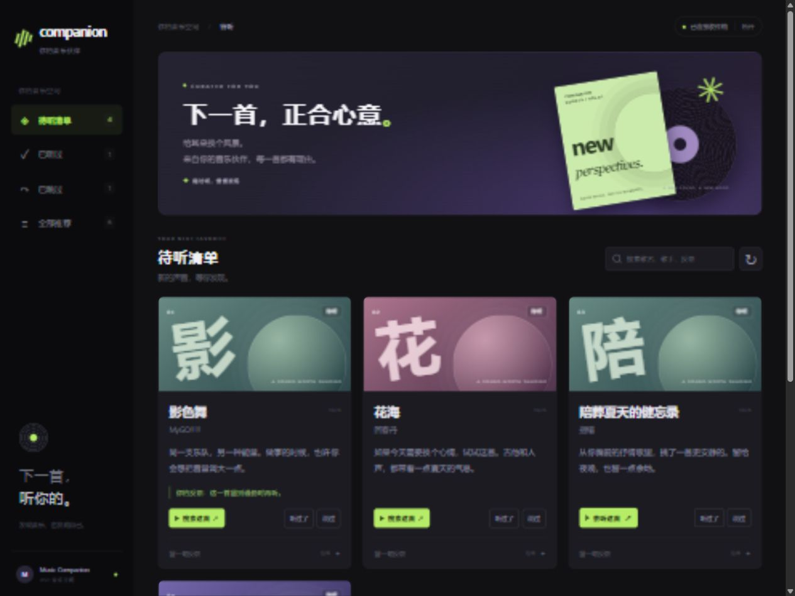

# dsh-music-companion

> 让你的 DSH 知道你在听什么，并且听得懂。

一个很小的扩展：桌面端读出系统媒体会话里正在播放的歌，经一个极简 hub 传给远端 agent。于是她能在聊天里自然接一句「你在听《春日影》？」，也能慢慢攒出你的听歌口味，哪天主动推一首过来。(本项目大部分代码由dsh生成，可能存在一些未知bug 欢迎提交修改)

**目前的更新状态：v0.3更新完成 暂未上架dsh插件市场**

---

## 它长什么样

下面两段是真实对话（已脱敏）。

**她读得懂你在听什么**

> 从今天的记录里看：
> 你的主线是日系乐队那种"动画片尾曲感"——ずっと真夜中でいいのに、ヨルシカ、MyGO、トゲナシトゲアリ，术力口那一块也不少。
> 但你又很吃杂食：从白光的老上海跳到巴西 funk、phonk，中间夹一笔说唱，还听了一段《觉醒年代》配乐。
> 晚上你偏抒情：悔やむと書いてミライ、影色舞、綺麗事这一串，情绪挺沉。白天赶工就挑有鼓点的。
> 还有一个发现，你一天扫了六十来首，很多听了 20 秒就切——你不是在听，你是在挑。

她读到的是 `music_history`：歌名、歌手、**以及每首听了多久**。"20 秒就切"和"从头听到尾"在她眼里是两种完全不同的事。

**她会自己开口**

> （你切到《アシェンプテル》，暂停在中段）
> 还在放《アシェンプテル》，暂停在中段。是路上听了一半就下车了，还是切出去不听了？到家了吗？

这次不是你去问她。`behavior.onSongChange` 决定她能不能开口，`quietHours` 和 `minGapSeconds` 决定她多久才说一次——免得变成每换一首歌就播报的复读机。

---

## 它不做什么

先划清边界，省得误会：

- **不是播放器。** 在 DSH 里放歌这件事已经有人做得很好了（见[相关项目](#相关项目)）。
- **不上传音频。** 只传几行元数据，没有音频流。
- **不碰你的账号凭证。** 不读 cookie、不登录、不调网易云的私有接口。歌曲 ID 是从客户端自己的播放队列文件里读的，纯粹是本地文件。
- **不保证 7×24 采集。** 插件形态下，只有 **DSH 进程活着** 的时候才读得到系统媒体会话——DSH 退出（托盘图标右键「退出」）或电脑睡眠期间什么都不记。想做到「只要开机就在听」，要么给 DSH 开开机自启，要么用独立进程方式跑（见[快速开始](#快速开始)里的方式 B）。两条路的数据格式完全一样，同时跑也不冲突。

## 它做什么

| 能力 | 版本 |
|---|---|
| 知道你此刻在听什么、有没有在听、听到第几秒 | 现版本 |
| 记住你最近听过哪些歌、每首听了多久  | 现版本 |
| 拿到歌曲 ID、时长、来源（音乐 / B站视频 / 其他） | 现版本 |
| agent 主动把歌推进你的推荐队列 | 现版本 |
| 换歌时自己决定要不要搭话（而不是每首都播报） | 现版本 |
| 记住口味，推歌之后知道有没有被听 | 现版本 |
| 打包成 DSH host 插件 | 现版本 |
| 上架 DSH 插件市场 | v0.4 |
| 让dsh能登上网易云 开启一起听 | v0.4 |


---

## 架构

三层，中间只有一个 HTTP 边界。任何一层挂了都不影响聊天——音乐是附加层，不是依赖。

```
┌───────────────────────────┐
│  你的电脑                  │
│                           │
│  网易云 / Spotify / B站    │
│      ↓ 系统媒体会话(SMTC)  │
│  watcher  ── 每 20s 读一次  │
│      │  + 本地队列查 song id│
└──────┼────────────────────┘
       │  POST /v1/now-playing
       │  （每轮都发，带进度）
       ▼
┌───────────────────────────┐
│  music-hub（一台小服务器）  │
│  收 · 存 · 给              │
│  纯 Node，零依赖，无数据库   │
└──────┬────────────────────┘
       │  127.0.0.1
       ▼
┌───────────────────────────┐
│  mcp-music                 │
│  三个工具：在听什么 / 最近听 │
│  / 推首歌                   │
└──────┬────────────────────┘
       ▼
   DSH agent
```

### 为什么用系统媒体会话

Windows 10 起有个系统级接口 `Windows.Media.Control`，任务栏那个播放小条就是它。它不碰任何播放器的内部结构，换网易云、Spotify、foobar2000 都能读到，也不会随客户端版本失效。

代价是**网易云不上报播放位置**（`Position` 永远是 0）。所以它的进度是 watcher 自己累加推断的：换歌从 0 开始，按前一次采样的播放状态累加，暂停期间不计时。支持播放位置的播放器优先使用 SMTC 报告的位置。

**听歌时长和播放位置分开记录。** 拖到第 3 分钟不代表听了 3 分钟；`listenedSeconds` 只累计实际采样到的播放时间。播放器消失、来源被过滤、SMTC 读取失败或采样间隔超过两轮时，不补算中间的空白时间。轮询仍有边界误差，网易云的估算进度也无法跟随拖动进度条。

### 为什么读本地队列拿 song id

agent 想查歌词、拉热评、找相似歌，都得先有数字 id，而 SMTC 只给歌名和歌手。按名字去搜索接口反查，同名歌一撞就废。

网易云客户端自己会在 `%LOCALAPPDATA%\Netease\CloudMusic\webdata\file\playingList` 里写一份播放队列，带精确 id 和时长，是明文 JSON。读它比调接口更准、更快、也更不容易被风控。

匹配时有个坑：SMTC 常常只报主歌手（「指错」），本地队列里却是全部歌手（「指错/星尘」）。所以匹配是分级的——先找歌手集合完全一致的，再找歌手互相包含的，最后如果歌名在队列里唯一就直接用。

---

## 快速开始

需要 Node.js ≥ 22。**只能在 Windows 上用**（读的是系统媒体会话）。

### 方式 A：装成 DSH 插件（推荐，一步搞定）

```bash
dsh plugin --profile <你的 profile> add /absolute/path/to/packages/watcher
```

装完**重启一次 DSH**——host 插件只在启动时加载，装着不重启是跑不起来的。

插件自己做三件事：

1. 起一个本地 hub（`127.0.0.1:8787`，数据在 `~/.dsh-music-companion/data/`）
2. 每 20 秒读一次系统媒体会话，上报给 hub
3. 把六个工具注册进 agent（音乐状态、历史、推荐、口味，以及推荐收件箱与反馈）

重启后直接问她「我在听什么」，不用另起进程、也不用配 MCP。

> **采集只在 DSH 进程活着时进行。** DSH 退出（托盘图标右键「退出」）或电脑睡眠期间不记录。要真正「开机就在听」，给 DSH 开开机自启即可。

**想接自己的服务器？** 在 `config.json` 里把 `hub.url` 指向它——只要不是 `127.0.0.1` / `localhost`，插件就会跳过内置 hub，直接往那边报（跨机器场景见方式 B）。

### 方式 B：手动部署（跨机器 / 调试用）

三件套分开跑，适合 watcher 和 agent 不在同一台机器的情况。

**1. 起 hub**

```bash
MUSIC_HUB_TOKEN=$(openssl rand -hex 24) node packages/music-hub/src/hub.mjs
```

默认监听 `127.0.0.1:8787`。数据落在 `packages/music-hub/data/`，纯 JSON，出问题 `cat` 一下就能明白。

要跨机器用，把 `MUSIC_HUB_HOST` 设成 `0.0.0.0`，并且**务必设一个足够长的 `MUSIC_HUB_TOKEN`**——`/v1/*` 全部接口都要鉴权。

**2. 起 watcher**

```bash
MUSIC_HUB_URL=http://127.0.0.1:8787 \
MUSIC_HUB_TOKEN=<上面那个> \
node packages/watcher/watcher.mjs
```

加 `--once` 只读一次就退出，适合确认到底读到了什么；平时调试不重启 DSH 就用这个方式。

**3. 挂 mcp-music**

```bash
npm install --prefix packages/mcp-music
```

然后在 DSH 的 MCP 配置里加一条：

```yaml
mcp-servers:
  mcp-music:
    command: node
    args: ["/absolute/path/to/packages/mcp-music/src/server.mjs"]
    env:
      MUSIC_HUB_URL: "http://127.0.0.1:8787"
      MUSIC_HUB_TOKEN: "<同一个 token>"
```

现在问她「我在听什么」，她会去查。

每 20 秒读一次，每轮都上报（进度在变），但相同的歌只会写一次历史。

---

## 配置与调参

三个组件共用一份 `config.json`，改一个地方三个都读到。

### 文件放哪

按顺序找，取第一个存在的：

1. `$MUSIC_CONFIG` 指定的路径（临时切换配置、调试用）
2. `./config.json`（在仓库根目录跑时最方便）
3. `$XDG_CONFIG_HOME/dsh-music-companion/config.json`
4. `~/.config/dsh-music-companion/config.json`
5. `%APPDATA%\dsh-music-companion\config.json`（Windows）

仓库根目录的 `config.example.json` 复制成 `config.json` 就能用，后者已被 `.gitignore` 排除。

**优先级：环境变量 > config.json > 内置默认值。** 环境变量永远能临时压过文件，试参数时不用改文件。

### 完整参数

| 键 | 环境变量 | 默认 | 说明 |
|---|---|---|---|
| `hub.url` | `MUSIC_HUB_URL` | `http://127.0.0.1:8787` | hub 地址，watcher 与 mcp 都读 |
| `hub.token` | `MUSIC_HUB_TOKEN` | 空 | `/v1/*` 全接口的鉴权密钥 |
| `hub.host` | `MUSIC_HUB_HOST` | `127.0.0.1` | hub 绑定地址，跨机要改成 `0.0.0.0` |
| `hub.port` | `MUSIC_HUB_PORT` | `8787` | hub 端口 |
| `hub.dataDir` | `MUSIC_HUB_DATA` | `packages/music-hub/data` | 数据落盘目录 |
| `hub.staleSeconds` | `MUSIC_HUB_STALE_SECONDS` | `600` | 多久没更新就标 `stale: true` |
| `watcher.pollSeconds` | `MUSIC_POLL_SECONDS` | `20` | 多久读一次系统媒体会话 |
| `watcher.device` | `MUSIC_DEVICE` | `desktop-windows` | 设备标识，多机时区分 |
| `watcher.ignoreSources` | — | `[]` | 不当作"在听歌"的来源 |

### 过滤不想被记录的来源

`watcher.ignoreSources` 收 `netease` / `bilibili` / `other` 三个值。被过滤的来源 watcher 根本不会上报，hub 和 agent 都看不到——看网课不该进听歌记录。

```json
"watcher": { "ignoreSources": ["bilibili"] }
```

### 主动开口

`behavior` 段决定「她什么时候该主动说话」。换歌时 hub 按策略决定要不要叫醒 agent，叫醒之后**说不说由 agent 自己判断**——不想说就当没看见。

| 键 | 说明 | 默认 |
|---|---|---|
| `onSongChange` | `always` 每首都接话 / `ask` 看她心情 / `silent` 从不主动 | `ask` |
| `minGapSeconds` | 两次主动开口之间的最小间隔，防刷屏 | `180` |
| `quietHours` | 这段时间内绝不主动说话，支持跨零点 | `["23:30","07:00"]` |
| `ignoreSource` | 这些来源的变化不触发发言 | `["bilibili"]` |
| `notify.kind` | `none` 只记录不打扰 / `qq-bridge` 通过 QQ 桥接叫醒 / `webhook` 通用 | `none` |
| `notify.url` | `qq-bridge` 模式下的地址，如 `http://127.0.0.1:3100` | — |
| `notify.consoleToken` | 桥接控制台令牌 | — |
| `notify.key` | 会话标识，如 `private:1234567` | — |
| `notify.message` | 叫醒时的提示词，支持 `{title}` `{artists}` `{album}` | 见 `config.example.json` |

**为什么只叫醒、不直接把歌名塞进对话**：把歌名塞给它，它就只会复述歌名；只告诉它「有变化了」，它才会自己决定要不要看、要不要开口。真人也不是每首歌都要点评一句。

**一个必须知道的细节**：`qq-bridge` 的 `notify-ai` 触发的是 **silent 回合**——那一轮 agent 的文字输出不会自动发到 QQ，它必须显式调用发送工具（例如 `qq_send_private_message`）才发得出去。这是设计使然（避免打扰），不是 bug。

### 调试

**看 watcher 到底读到了什么**：

```powershell
node packages\watcher\watcher.mjs --once
```

启动时会打三行：配置来源、读到的本地队列条数、这一轮的歌。链路通不通一眼就看得出来。

**确认 hub 收到没有**：

```bash
curl -sS -H "Authorization: Bearer $TOKEN" http://127.0.0.1:8787/v1/now-playing
```

**看 hub 日志**：

```bash
tail -f /var/log/music-hub.log
```

**塞一条假数据试场景**（注意 `track` 这一层不能省，直接发 `{"title":...}` 会返回 `track.title is required`）：

```bash
curl -sS -X POST -H "Authorization: Bearer $TOKEN" -H "Content-Type: application/json" \
  -d '{"track":{"title":"晴天","artists":["周杰伦"],"duration":269},"progress":30,"playing":true}' \
  http://127.0.0.1:8787/v1/now-playing
```

Windows 上别在 PowerShell 里硬拼 JSON 引号，写成文件再 `--data-binary @payload.json` 省事得多。

---

## 工具

| 工具 | 说明 |
|---|---|
| `music_now_playing` | 现在在听什么：歌名、歌手、专辑、ID、时长、进度、累计听歌时间、来源 |
| `music_history(limit)` | 最近听过的歌，倒序，附「上一首听了多久」 |
| `music_recommend(title, artist, reason?, id?)` | 把一首歌放进推荐收件箱，返回推荐 ID 与收件箱地址 |
| `music_taste(...)` | 读/写她对主人口味的了解。不带参数是读，带参数是整体覆盖写 |
| `music_recommendations(status?, limit?, query?)` | 查看待听 / 已听过 / 已跳过的推荐，包含推荐理由、歌曲链接和主人反馈 |
| `music_recommendation_feedback(recommendationId, status, note?)` | 标记听过、跳过或放回待听，可附一句反馈 |

`music_now_playing`、`music_history`、`music_recommendations` 只读，其余工具可写入数据。

**推荐闭环**：`music_recommend` 写进去的是 `status: "pending"`。等你真的听了那首歌（watcher 上报的歌名/歌手能对上），hub 会自动把它标成 `listened` 并记下听到的时刻——这样她下次就知道自己的推荐准不准。

**口味怎么来的**：`music_taste` 是一个空槽，插件不替你总结。她可以自己从 `music_history` 里看出「这个人连续听了三首回春丹」，然后调 `music_taste` 写下来：歌手亲密度（-5..5）、风格标签、几句笔记。下次再推歌前先读一次，就不会推你已经明确不喜欢的东西。

### 推荐收件箱



推荐有了一个可以实际打开的地方：启动 hub 后，在浏览器访问 [本机推荐收件箱](http://127.0.0.1:8787/recommendations)；自建服务器则访问 `<hub 地址>/recommendations`。跨机部署需要同步更新 hub，界面由 hub 提供。

1. 输入 hub 访问令牌。插件内置 hub 使用 `hub.embeddedToken`，默认 `local-dev`；独立 hub 使用 `MUSIC_HUB_TOKEN` 或 `hub.token`。令牌仅保存在当前浏览器标签页中，通过请求头发送。
2. 按「待听」「已听过」「已跳过」筛选，或搜索歌名、歌手、推荐理由和反馈。有网易云歌曲 ID 的推荐可直接打开歌曲页；缺少 ID 时提供歌曲搜索入口。
3. 听过后可以标记「听过了」，不感兴趣则跳过，也能重新放回待听。展开「留一句反馈」可保存一句具体意见。打开链接本身不会标记已听，不会自动播放或切歌。

agent 可以先用 `music_recommendations(status="skipped")` 看你跳过了哪些歌及原因，再决定下一次推荐。`music_recommendation_feedback` 用的是**推荐 ID**，由收件箱返回；它与网易云的歌曲 ID 是两回事。反馈不会自动覆盖 `music_taste`，口味仍由 agent 自己维护。

同一首待听歌曲重复推荐只保留一条。网易云的精确 ID 优先用于自动确认已听；没有可比较的 ID 时，按完整歌名与歌手匹配，避免把现场版、翻唱版或名字相似的歌混在一起。已跳过的记录不会被播放上报改回已听。队列继续只保留最近 200 条推荐，旧数据无需迁移。

想先看效果，可以用独立的示例数据运行：

```bash
npm run demo:inbox
```

终端会显示一个临时的本机地址和演示令牌。演示不读个人配置，关闭后清理临时数据。

#### 收件箱 API

所有 `/v1/*` 接口仍需鉴权：

| 接口 | 说明 |
|---|---|
| `GET /v1/recommendations` | 保留原有全部推荐、从旧到新的返回顺序；额外返回 `counts` 和匹配总数 `total` |
| `GET /v1/recommendations?status=pending&order=newest&limit=20&q=乐队` | 状态可为 `pending/listened/skipped/all`，`limit` 为 1..200，`q` 搜索文本 |
| `POST /v1/recommend` | 兼容原来的 `id` 参数，歌曲 ID 单独存为 `songId`；返回推荐 `item` 和是否重复的 `duplicate` |
| `POST /v1/recommendations/<推荐ID>/feedback` | JSON：`{"status":"skipped","note":"想听更轻快的"}`；`note` 选填、最多 500 字，可用空字符串清除 |

`recommendations.json` 继续保存所有推荐、状态和反馈。界面是静态文件，不会把未鉴权的听歌数据或令牌嵌入 HTML，也不加载外部脚本、图片或字体。

#### 验证

```bash
npm test
npm ci --prefix packages/mcp-music
npm run test:mcp-inbox
```

第一项不需要安装依赖，覆盖队列逻辑以及插件 / 独立 hub 的真实 HTTP 请求。MCP 联调使用现有的官方 SDK，以 stdio 调用实际服务。

### 数据长什么样

hub 存的 `now-playing.json`：

```json
{
  "track": {
    "title": "陪葬夏天的健忘录",
    "artists": ["指错"],
    "album": "陪葬夏天的健忘录",
    "id": "2757490399",
    "duration": 218
  },
  "progress": 51,
  "playing": true,
  "listenedSeconds": 51,
  "device": "desktop-windows",
  "source": "netease",
  "startedAt": "2026-10-26T10:12:45.821Z",
  "updatedAt": "2026-10-26T10:13:36.317Z",
  "stale": false,
  "ageSeconds": 0
}
```

当前状态的 `listenedSeconds` 是当前歌曲累计听了多久；历史中一条记录的同名字段仍表示「换到这首歌之前，上一首累计听了多久」，第一条为 `null`。暂停/继续不会重复追加历史，暂停时选中的歌要等真正播放才入历史。配合上一首的 `duration` 就能判断你是听完了还是跳过：

- 听了 40s / 218s ≈ 18% → 跳过
- 听了 195s / 218s ≈ 89% → 听完

计数会随当前状态落盘，hub 重启后继续累计。旧 watcher 没有上报听歌计数时，hub 按播放状态和有效上报间隔估算，超过 `hub.staleSeconds` 的空白不计入。已有历史不改写；旧版当前状态缺少计数时从升级后的有效采样开始统计，不用墙上时间回推。

### 运行测试

仓库根目录执行，无需安装额外依赖，也无需实际打开播放器：

```bash
npm test
npm run test:smoke
```

回归测试覆盖插件与独立 hub 的 HTTP 行为、暂停/恢复、切歌、拖动进度、采集间断、重启恢复和连接配置。测试使用临时目录与临时端口，不读取个人配置或真实 SMTC 媒体数据。CI 在 Windows / Linux 的 Node.js 22 和 24 上运行。


---

## 设计取舍

- **状态用 JSON 文件，不用数据库。** 单用户、写频率不到 0.1Hz、读全在本机。文件的好处是出问题能直接看，agent 也能直接读。
- **同一首歌反复暂停不重复记。** 幂等键是 `歌名|歌手`，一首歌听一下午只算听了一次。
- **进度是自己算的，不是读的。** 网易云不报位置，只能靠累加计时。这是已知的精度损失，明写在数据里而不是假装准。
- **hub 不主动把歌名塞进对话。** v0.2 会改成「只告诉 agent 有变化」，由她自己决定接不接话——真人也不是每首歌都要评论。
- **来源单独一个字段。** SMTC 会把 B 站视频也算成"正在播放"，所以 `source` 用来区分 `netease` / `bilibili` / `other`，免得听歌记录里混进一堆网课。

---

## 相关项目

这几个都是「在 DSH 里放歌」，和我们方向不同，但值得一看：

- [doitian/dsh-music](https://github.com/doitian/dsh-music) — 带 AI DJ 的网易云播放器
- [ZhaoZiyangShaanxi/dsh-netease-music](https://github.com/ZhaoZiyangShaanxi/dsh-netease-music) — 读取本地客户端实现自动登录
- [Caiccc-a11y/dsh-wyymusic-player](https://github.com/Caiccc-a11y/dsh-wyymusic-player) — 右侧栏播放器

## 许可

MIT
